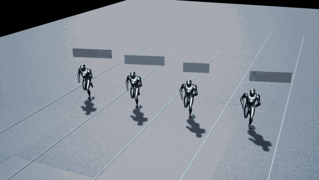

# Physics-Guided Character Animation

[Watch the demos](https://xiuyuyang.github.io/physics-guided-character-animation/) · [简体中文](README.zh-CN.md)

A running character can stumble, recover, or remain down. This project uses **Perpetual Humanoid Control (PHC)** and Isaac Gym to compute the response to an external force, then transfers the motion to Unreal Engine's Manny.

[](https://xiuyuyang.github.io/physics-guided-character-animation/)

## What to watch

| Unreal recording | What it shows |
| --- | --- |
| [Same force, different contact points](https://xiuyuyang.github.io/physics-guided-character-animation/#title) | At 250 N the lower-leg trial keeps running, the shoulder trial gets up, and the chest trial remains down through the clip. The fourth lane is a control. |
| [Recovery before and after](https://xiuyuyang.github.io/physics-guided-character-animation/#recovery) | The same shoulder reaction in both views. The revised version blends the final steps into a phase-matched run over 32 frames (1.07 s). |
| [Three drop sizes and a collision control](https://xiuyuyang.github.io/physics-guided-character-animation/#drops) | 12, 45 and 100 cm spheres in a 16-runner formation. Compare the 100 cm case with runner collisions on and off. |
| [100-runner stress test](https://xiuyuyang.github.io/physics-guided-character-animation/#scale) | A 1 m sphere falls into the same-density crowd layout with 100 PHC-controlled runners. |
| [Boulder and eight runners](https://xiuyuyang.github.io/physics-guided-character-animation/#crowd) | Glancing contacts recover into running. Runners with severe impacts stay down. |
| [Flash pulse and stylized dart](https://xiuyuyang.github.io/physics-guided-character-animation/#projectiles) | Two game effects visualize the same point-force trials and recovery. |

## Run in Unreal

1. Install **Unreal Engine 5.8**, Python 3, and Epic's [Content Examples for Unreal 5.8](https://dev.epicgames.com/documentation/unreal-engine/content-examples-sample-project-for-unreal-engine?lang=en-US).
2. Clone this repository and run the following from its root in PowerShell. Pass the local Content Examples folder. If the engine lives outside Program Files, add `-UnrealRoot "D:\Epic Games\UE_5.8"`.

   ```powershell
   python -m pip install -r requirements.txt
   .\Setup-Unreal.ps1 -ContentExamples "C:\Unreal Projects\Content Examples"
   ```

3. Open [BoulderCrowd.uproject](Unreal/BoulderCrowd/BoulderCrowd.uproject) and hit **Play**. Open `LS_Recovery_250` in Sequencer to step through the pulse at frames **60–63** and the shoulder's recovery blend at **133–165**.

| Map | Playback |
| --- | --- |
| `L_Recovery_250` / `L_Recovery_700` | Matched-contact runs with the phase-aligned recovery |
| `L_Contact_250` / `L_Contact_700` | Original PHC trials for comparison |
| `L_BoulderCrowd` | Eight-runner crowd scene |
| `L_Drop_Palm` / `L_Drop_Medium` / `L_Drop_Large` | 16 runners with three sphere sizes and one material density |
| `L_Drop_Isolated` / `L_Drop_100` | Runner collisions off for the 16-runner control, and a separate 100-runner test |
| `L_Pulse` / `L_Dart` | Two visualizations of the optimized localized contacts |

The setup script imports Manny from your local Epic sample and bakes the maps, animations, and trajectories from the included trial data. New physical simulations require a separate PHC / Isaac Gym setup.

In the dense scenes, the 12 cm release position was moved about 12 cm to make contact at the edge of the pack. Contact markers are inferred from force and proximity and checked against a runner-collisions-off trial. The terminal branch is a game-state rule documented with the [trial results](evidence/impact-showcase/).

## How it works

1. Start each localized trial at the same run phase. In three independent runs, apply a four-step force pulse at a specific point on a PHC rigid body. The cyan marker shows the transferred contact location.
2. Convert the recorded body poses and root motion to Manny. For characters that stand again, detect foot support, choose a matching phase of the reference run, and blend pose and speed into that loop.
3. Bake the resulting motion into Unreal Sequencer. The [runtime audit](evidence/contact-probe/exact-contact/recovery-runtime-audit.json) records a maximum root-speed jump of **0.000037 m/s** across the three evaluated handoffs.

See [motion conversion code](tools/), [recorded trials and audit](evidence/contact-probe/exact-contact/), and [credits](THIRD_PARTY.md).
