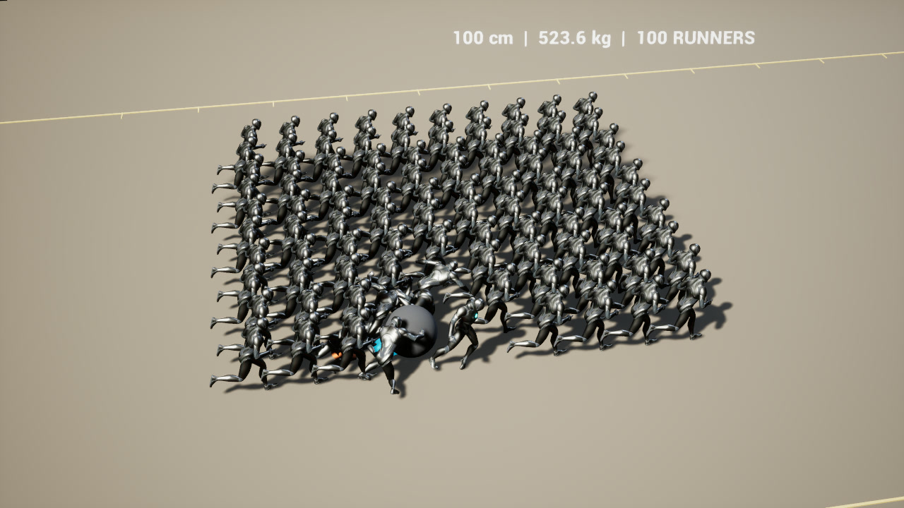

# 神经网络驱动的角色骨骼动画

[观看最终演示](https://xiuyuyang.github.io/physics-guided-character-animation/zh/) · [English](README.md)

**基于 PHC 预训练神经网络的物理角色控制，支持 100 人同场受力、跌倒和恢复奔跑。** 每个角色独立响应落石与周围人物的碰撞，生成的骨骼运动重定向到 Unreal Engine 的 Manny。

[](https://xiuyuyang.github.io/physics-guided-character-animation/zh/)

## 最终成果

- [100 人场景](https://xiuyuyang.github.io/physics-guided-character-animation/zh/#scale)展示 8 秒仿真。四名角色完成起身接跑，九名进入死亡终止状态后保持倒地。
- [三种落石](https://xiuyuyang.github.io/physics-guided-character-animation/zh/#drops)展示 12、45、100 厘米球体进入 16 人密集队列。密度统一，质量随体积变化。
- [局部命中](https://xiuyuyang.github.io/physics-guided-character-animation/zh/#projectiles)用闪光脉冲和箭形道具展示同一组点力数据下的角色反应。

## 神经网络驱动流程

**角色状态与参考运动 → PHC 神经网络推理 → 关节控制动作 → PD 与 PhysX → 骨骼运动 → Manny 重定向与 Unreal 播放。**

角色共享策略权重，各自保持独立的物理状态。神经网络在离线仿真中持续控制受力后的姿态和恢复尝试。Unreal 播放烘焙结果，起身后接跑的相位匹配与速度过渡由代码处理。死亡是场景定义的终止规则。本项目使用现有 PHC 预训练权重。

## 在 Unreal 里运行

1. 安装 **Unreal Engine 5.8**、Python 3 和 Epic 的 [Unreal 5.8 Content Examples 示例工程](https://dev.epicgames.com/documentation/unreal-engine/content-examples-sample-project-for-unreal-engine?lang=en-US)。
2. 克隆仓库，在仓库根目录的 PowerShell 中执行以下命令。将参数改为本机示例工程文件夹。如果引擎装在其他目录，可加上 `-UnrealRoot "D:\Epic Games\UE_5.8"`。

   ```powershell
   python -m pip install -r requirements.txt
   .\Setup-Unreal.ps1 -ContentExamples "C:\Unreal Projects\Content Examples"
   ```

3. 打开 [BoulderCrowd.uproject](Unreal/BoulderCrowd/BoulderCrowd.uproject)，打开最终关卡 `L_Drop_100` 并点 **Play**。对应的 `LS_Drop_100` 可逐帧检查。

安装脚本从本机 Epic Content Examples 导入 Manny，并从仓库数据重建最终演示。新物理试次需要单独配置 PHC 与 Isaac Gym。

[素材来源与鸣谢](THIRD_PARTY.md) · [PHC 上游项目](https://github.com/ZhengyiLuo/PHC)
